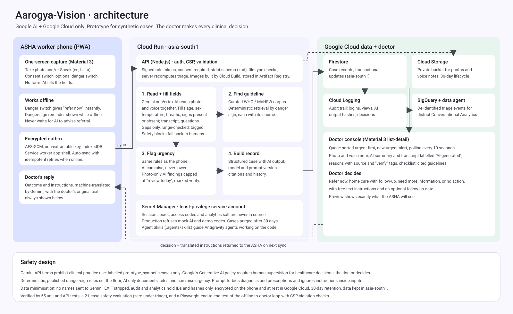

# Aarogya-Vision

**A photo and a voice note from an ASHA worker become a doctor-ready, guideline-cited case, with urgent newborns flagged first.**

Built for Google DeepMind × Google Cloud **Startup Buildathon India 2026** on Google AI (Gemini) and Google Cloud only.

> **Prototype.** Use synthetic or role-play cases only. Not for clinical use. AI output is a documentation aid; the doctor makes every clinical decision.

Full background, buildathon rules, design decisions and status: **[KNOWLEDGE.md](KNOWLEDGE.md)**.



## The problem

ASHA workers are often a village's first health contact, but they cannot *show* a remote doctor what they see. Cases reach doctors by phone or on paper, late and unstructured, and danger signs in newborns are missed.

## What this MVP does

One clinical scenario, end to end: **home visits for young infants (0-59 days)**, using the WHO / MoHFW IMNCI danger signs.

1. **Capture in seconds (ASHA phone, works offline).** Two big buttons, **Take photo** and **Speak**. Use either or both, in English, Hindi or Tamil. One consent switch, and an optional **I see a danger sign** switch. There is no form to fill in.
2. **Gemini fills the fields.** Gemini reads the photo and voice note together. It fills in the baby's age, sex, temperature, breath count and which danger signs the worker said were present or absent. It also returns a transcript, an English translation and follow-up questions. It does not diagnose or prescribe.
3. **The worker sees what was understood.** The phone shows the urgency result and a **What we understood** card: each value is tagged *from voice* or *from photo*, and the card lists the questions the doctor may ask.
4. **Offline-safe.** Without network, the visit is encrypted on the phone (AES-GCM, non-extractable key) and sends itself when the network returns. Meanwhile the phone shows a "refer now if you see any of these" danger-sign list. The danger switch gives *Urgent: refer now* instantly, with no AI or network needed.
5. **Cited guidance.** Each case cites curated WHO / MoHFW guidance, matched deterministically to its danger signs.
6. **Safe urgency.** Deterministic rules run on the AI-filled values. AI findings can **raise** urgency, never lower it. A voice-only case without an answer for every sign is at least *doctor review today*. Photo-only AI findings are capped at *review today* and marked *verify*.
7. **Doctor decides.** A Material 3 console lists urgent cases first. It shows the photo, voice note, labelled AI summary, every AI-filled value tagged with its source, and the citations. The doctor records an outcome and instructions.
8. **Act.** The ASHA sees the reply, machine-translated into her language by Gemini, with the doctor's original text always shown below.

## Google stack

| Need | Google service / tool | Where |
|---|---|---|
| Multimodal understanding (photo + voice + form) | **Gemini** (`gemini-3.8-flash` by default) via **Vertex AI** in production, Gemini API key in dev | `src/ai/gemini.js`, `src/ai/prompt.js`, `src/ai/schema.js` |
| Structured output, safety filters | Gemini `responseJsonSchema`; blocked responses fall back to human review | `src/ai/gemini.js` |
| Translation of doctor instructions | Gemini | `src/ai/gemini.js` |
| Prompt testing and model choice | **Google AI Studio** | `docs/ai-studio/` |
| Hosting | **Cloud Run** (asia-south1), built by **Cloud Build**, images in **Artifact Registry** | `Dockerfile`, `scripts/deploy-cloudrun.sh` |
| Case records | **Firestore** (Native mode) | `src/store/gcpStore.js` |
| Photos and voice notes | **Cloud Storage** (private bucket, 30-day lifecycle) | `src/store/gcpStore.js` |
| Secrets | **Secret Manager** | `scripts/deploy-cloudrun.sh` |
| Audit trail | **Cloud Logging** (structured logs) | `src/audit.js` |
| District analytics | **BigQuery** + BigQuery data agent (Conversational Analytics) | `src/analytics.js`, `docs/bigquery-data-agent.md` |
| UI | **Material 3**: official `@material/web` components, tokens from **Material Color Utilities**, Material Symbols, Roboto and Noto fonts (self-hosted) | `ui/`, `scripts/build-ui.mjs`, `public/` |
| Agentic development | **Google Antigravity** with project **Agent Skills** | `.agents/skills/` |

No third-party AI, database, hosting, analytics, font or icon services are used at runtime. Open-source libraries: Express, Multer, Helmet, zod, plus Playwright and esbuild for dev.

## Safety and responsible AI

- **Google terms.** The [Gemini API Additional Terms](https://ai.google.dev/gemini-api/terms) prohibit use "in clinical practice, to provide medical advice, or in any manner that is overseen by or requires clearance or approval from a medical device regulatory agency". This build is therefore a labelled prototype for synthetic cases. A field pilot would need Vertex AI under Google Cloud terms, clinical validation and a regulatory pathway (for example CDSCO software-as-a-medical-device).
- **Human supervision.** Google's [Generative AI Prohibited Use Policy](https://policies.google.com/terms/generative-ai/use-policy) disallows automated healthcare decisions without human supervision. Here the doctor decides every case. The phone's urgent advice comes from published, deterministic danger-sign rules, not from AI.
- **AI can only raise urgency.** Enforced in `public/shared/triage.js` and covered by tests. Values Gemini fills in never override what the worker entered, are range-checked, and are tagged with their source in both UIs.
- **Non-diagnostic prompt.** The prompt forbids diagnoses, medicines and urgency decisions, asks for explicit evidence only, and tells the model to ignore instructions inside the voice note or notes (prompt injection).
- **Fail safe.** Safety blocks, timeouts, invalid JSON or schema failures mark the AI step as failed and raise the case to human review.
- **Transparency.** Every AI output is labelled *AI-generated* with its model. Findings show their source and a *verify* tag. Translations are labelled machine-translated, with the original shown.
- **Data minimisation.** No names go to Gemini (age, sex, checklist, vitals and notes only). The optional reference field is initials only. Re-encoding the photo strips EXIF and GPS data.
- **Security.** Signed role tokens, strict schema validation, file-type sniffing, and media served only to doctors. Strict CSP (scripts `'self'`; only style attributes inline, which Material Web needs), rate-limited login. Production refuses demo codes and the mock AI provider.
- **Privacy.** Data is encrypted on the phone, and at rest in Firestore and Cloud Storage (Google-managed encryption) in asia-south1. Cases are purged after 30 days. The audit trail and BigQuery analytics hold IDs, hashes and de-identified fields only.
- **Content review still needed.** The danger-sign wording, guideline corpus and Hindi/Tamil text are **drafts**. They need clinician and native-speaker sign-off.

## Run locally

Requires Node.js 22+.

```bash
npm install
cp .env.example .env        # AI_PROVIDER=mock works with no keys
npm run dev                 # builds the Material UI, then serves http://localhost:8080
```

- ASHA app: <http://localhost:8080/>. Demo code `asha-demo` (a second worker: `asha-demo-2`).
- Doctor console: <http://localhost:8080/doctor>. Demo code `doctor-demo`.

To use real Gemini, set `AI_PROVIDER=gemini` and either a `GEMINI_API_KEY` from Google AI Studio, or `GOOGLE_GENAI_USE_ENTERPRISE=true` with `GOOGLE_CLOUD_PROJECT` and `GOOGLE_CLOUD_LOCATION` (Vertex AI with your gcloud credentials).

## Three-minute demo

1. Open the ASHA app on a phone (or Chrome device mode), sign in, and switch to **தமிழ்** with the translate button.
2. Tap **New visit**, then **Speak**, and say: "Baby girl, 8 days old, not feeding since morning, feels hot, temperature 38.3, no fits." Turn on consent and tap **Send to doctor**.
3. A few seconds later: *Urgent: refer now*, and **What we understood** shows age 8 days, girl and 38.3 °C, each tagged *from voice*, plus the danger signs heard.
4. Turn the network off. Start another visit: take a photo only, turn on **I see a danger sign**, and send. *Urgent: refer now* and the danger-sign list appear instantly, and the visit is saved encrypted.
5. Turn the network on. The saved visit sends itself.
6. Open the doctor console. The urgent cases are at the top. Show the voice note, the labelled AI summary, the values tagged *(voice note, AI)*, and the WHO citation.
7. Choose **Refer now**, write instructions and send. Show the "What the ASHA sees" preview.
8. Back on the phone, the doctor's reply appears in Tamil with the original below.

With `AI_PROVIDER=mock` there is no model, so any voice note is "heard" as a fixed, clearly labelled demo transcript. Use a Gemini key for a live demo.

## Tests and evaluation

```bash
npm test               # 55 unit + API tests: rules, AI auto-fill, auth, idempotent sync, validation, audit,
                       # Gemini request shape and safety blocks, Firestore/GCS store, analytics de-identification
npm run test:e2e       # Playwright: offline photo-only visit -> encryption at rest -> auto-sync -> online
                       # voice-only visit auto-filled by AI -> doctor decision -> translated reply;
                       # fails on any CSP violation or console error
npm run eval           # 21 synthetic cases; fails on any under-triage
npm run eval -- --ai   # same cases through live Gemini; checks AI never lowers urgency (needs a key)
```

What was verified where:

- **Verified in this repository:** all of the above, run with the mock AI provider.
- **Verified against the SDK, not live:** the Gemini integration, checked against `@google/genai` request and response shapes. Run `npm run eval -- --ai` with a key to verify it live.
- **Verified against fakes, not real Google Cloud:** the Firestore and Cloud Storage store, against fakes of the client APIs. The deploy script was syntax-checked but not run from the build machine.

## Deploy to Google Cloud

From Cloud Shell, at the repository root:

```bash
PROJECT_ID=your-project ./scripts/deploy-cloudrun.sh
```

The script enables the APIs and creates Firestore, the private bucket, the BigQuery dataset, a least-privilege service account and Secret Manager secrets. It then builds with Cloud Build and deploys to Cloud Run in asia-south1. It prints one-time demo access codes and the service URL. Gemini runs on Vertex AI with the service account (no API key). Confirm that your chosen `GEMINI_MODEL` is available in `asia-south1`, or set `VERTEX_LOCATION` and update the data-residency statement above.

For analytics, see [docs/bigquery-data-agent.md](docs/bigquery-data-agent.md) to create a BigQuery data agent over the de-identified `triage_events` table.

## Building with Antigravity

`.agents/skills/` holds project Agent Skills that Antigravity loads on demand:

- `aarogya-clinical-safety` covers triage, prompt and medical-wording guardrails.
- `aarogya-add-language` adds a worker language.
- `aarogya-add-guideline` adds a cited guideline entry.
- `aarogya-deploy-cloud-run` covers Google Cloud deployment.
- `aarogya-material-ui` covers the Material 3 UI conventions.

## Project structure

```
public/            ASHA PWA (index.html), doctor console (doctor.html), service worker
public/shared/     danger signs + triage rules shared by phone and server
public/js/         UI controllers, i18n (en/hi/ta), encrypted outbox, media capture
src/               Express API, Gemini provider, pipeline, guideline retrieval, stores, audit, analytics
src/guidelines/    curated, cited guideline corpus (draft)
ui/, scripts/      Material Web bundle, theme tokens, icons, fonts, deploy, prompt export
test/, e2e/, eval/ unit/API tests, Playwright end-to-end test, safety evaluation set
.agents/skills/    Antigravity Agent Skills
```

## Limitations and roadmap

- **Next:** clinician validation of the rules and corpus, and native-speaker review of the Hindi and Tamil text.
- **Next:** live Gemini evaluation on role-played audio and photos.
- **Then:** Gemma on-device for offline voice transcription, Gemini Live for hands-free follow-up questions, and Pub/Sub push alerts for urgent cases.
- **Then:** FHIR R4 records through Cloud Healthcare API for ABDM readiness, more languages and conditions, and a district pilot.

## Buildathon checklist

- [x] New product idea, built on Google AI (Gemini) and deployable on Google Cloud (Cloud Run)
- [x] Prompts prototyped for Google AI Studio; Agent Skills for Google Antigravity
- [ ] Deploy with `scripts/deploy-cloudrun.sh` and test the live URL on a phone
- [ ] Submit the prototype by **9:00 AM on Day 2** (hard deadline, no extension)
- [ ] Presentation PDF, at most 5 MB
